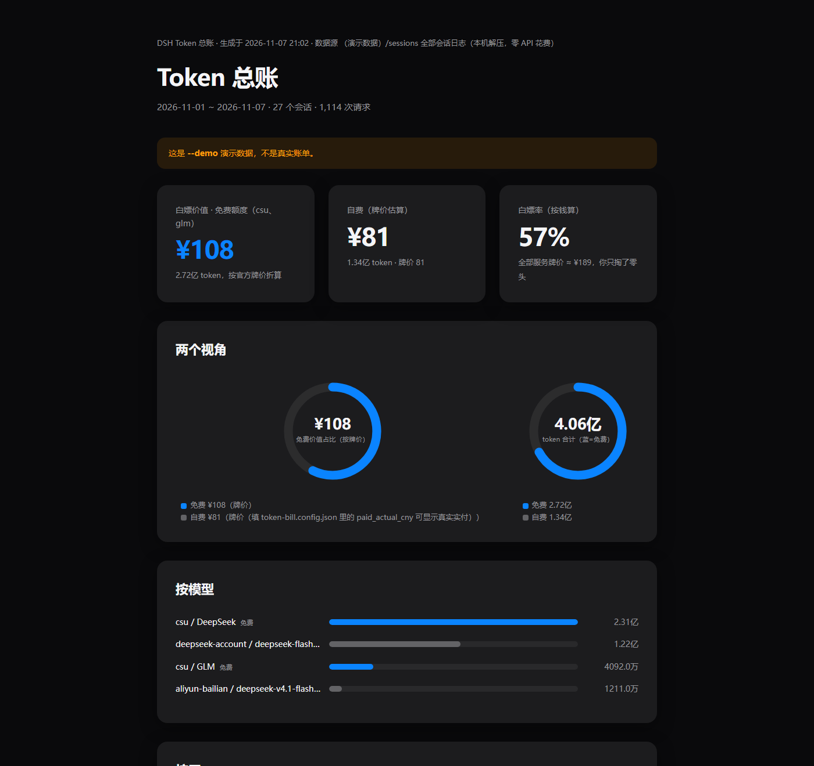

# dsh-token-bill

把 **DeepSeek Harness（DSH）** 的会话日志算成一张离线网页账单：白嫖了多少 token、自费了多少、每天烧了多少。

> A tiny offline token-bill generator for DeepSeek Harness.
> It decompresses your local `~/.dsh/sessions/**/*.zstd` logs, counts the tokens of every
> request, and renders one self-contained HTML page. **No network, no API calls, no telemetry.**



*（上图是 `--demo` 假数据渲染的演示页。）*

---

## 快速开始

### 方式一：下载压缩包（Windows，同学解压就能用）

1. 到本仓库的 [Releases](../../releases) 下载 `dsh-token-bill-v1.0.0-win64.zip`
2. **解压**（别在压缩包里直接双击），进 `dsh-token-bill` 文件夹
3. 双击 `dsh-token-bill.exe` → 同目录生成 `token-账单.html`，并用默认浏览器打开
4. 前提：这台机器上**装过 DSH 并且用过**（要有 `~/.dsh/sessions` 里的日志）

里面已经带了打包好的 Python 运行时，**不需要你自己装 Python**。

> 为什么是文件夹而不是单个 exe？试过 `--onefile` 单文件模式，在 Windows 11 build 26200 +
> PyInstaller 6.22 + Python 3.15 上启动时会 `Could not create temporary directory!`（换 %TEMP%、
> 换父进程都复现），文件夹模式没这个毛病，启动还更快、也不容易被杀软误判。

### 方式二：源码运行

```bash
# 需要 Python 3.14+（用的是标准库里的 compression.zstd）
python token_bill.py                 # 生成网页并打开
python token_bill.py --print         # 只在控制台打印摘要
python token_bill.py --json          # 输出机器可读 JSON
python token_bill.py --demo          # 用假数据渲染一张演示页（测试用）
```

Python 3.12 / 3.13 也能跑，但要额外装解压库：`pip install zstandard`。

---

## 它到底在算什么

| 项 | 说明 |
|---|---|
| 数据源 | `%DSH_HOME%\sessions\**\session*.jsonl.zstd`（默认 `~/.dsh/sessions`） |
| 用量字段 | `assistant/message.data.usage`（每次模型请求）、`compaction/summary.data.usage`（每次上下文压缩） |
| 模型归属 | 取该请求之前最近一次 `request/context` 或 `request/header` 里的 provider/model |
| 免费 / 自费 | provider 或模型名里命中 `free_providers`（默认 `csu`、`glm`）算**免费额度**，其余算**自费**，认不出算「未知」 |
| 免费价值 | 按官方无缓存牌价折算（输入 ¥2 / 输出 ¥3 每百万 token）——校园 API 不计缓存价 |
| 自费牌价 | 输入 ¥2 + 缓存读 ¥0.2 + 输出 ¥3 每百万 token |
| 自费实付 | **推荐手填**：账号后台的真实账单金额，比任何估算都准（见下面的配置） |

**不在统计范围内的**：网页版对话、DSH 自己生成的会话标题、任何不经 DSH 会话日志的调用。
装机之前的历史也无记录——这是一份「日志里有什么就算什么」的账。

---

## 配置（可选）

把 `token-bill.config.example.json` 复制成 `token-bill.config.json`，放在 exe / 脚本旁边：

```json
{
  "dsh_home": "",
  "output": "token-账单.html",
  "free_providers": ["csu", "glm"],
  "list_price": { "input": 2.0, "cache_read": 0.2, "output": 3.0 },
  "bill_rate": 0.0401,
  "paid_actual_cny": null,
  "paid_actual_date": ""
}
```

| 字段 | 作用 |
|---|---|
| `dsh_home` | DSH 目录；留空则用 `%DSH_HOME%`，再退回 `~/.dsh` |
| `output` | 网页输出路径（相对路径按 exe / 脚本所在目录算） |
| `free_providers` | 哪些 provider / 模型算「免费额度」，大小写不敏感，子串匹配 |
| `list_price` | 官方牌价（元/百万 token），用来折算「这些调用如果按量付费值多少钱」 |
| `bill_rate` | 你实测的均价（元/百万 token），默认 4.01 分/百万；用于「按量付费大概多少钱」的旁证 |
| `paid_actual_cny` | **你账号后台的真实实付金额**；填了它，页面上的「自费」就显示真钱而不是估算，白嫖率也跟着变准 |
| `paid_actual_date` | 上面那个金额是哪天查的 |

也可以不建配置文件，直接用命令行临时指定：

```
dsh-token-bill --paid 26.5 --paid-date 2026-11-05
dsh-token-bill --dsh-home D:\somewhere\.dsh
```

想生成一份配置模板：`dsh-token-bill --init-config`。

---

## 命令行参数

| 参数 | 作用 |
|---|---|
| （无参数） | 生成网页 + 打开浏览器 + 打印摘要 |
| `--no-open` | 只生成，不打开浏览器 |
| `--out 路径` | 指定输出 html（等同 `--html`） |
| `--print` | 只在控制台打印摘要 |
| `--json` | 输出 JSON（含 `by_model` / `by_day` / `money`） |
| `--demo` | 用假数据渲染演示页 |
| `--dsh-home 路径` | 指定 DSH 目录 |
| `--config 路径` | 指定配置文件 |
| `--init-config` | 写一份默认配置文件后退出 |
| `--paid 金额`、`--paid-date 日期` | 覆盖真实实付金额 / 日期 |
| `--version` | 版本号 |

---

## 常见问题

**页面上一片 0 / 提示没找到日志？**
这台机器没装 DSH，或者还没用它跑过对话。日志在别的位置就用 `--dsh-home 路径` 指过去。

**「白嫖」和「自费」分错了？**
改配置里的 `free_providers`，加你那个免费 provider 的名字（比如 `qwen`、`ollama`、`siliconflow`）。

**自费金额不对？**
页面上默认给的是**牌价估算**。真实金额去你 API 平台的账单页看，填进 `paid_actual_cny` 就准了。

**Windows Defender / 杀软报毒？**
PyInstaller 单文件 exe 的老毛病（自解压行为容易被启发式盯上）。不放心就用源码方式跑，逻辑全在这一个 `token_bill.py` 里，一眼能看完。

**会把我数据传到哪吗？**
哪都不传。整个过程就是「读本地日志 → 算 → 写一个 html」，没有网络代码，没有第三方依赖（源码方式只依赖 Python 标准库）。

**为什么不用 API 平台的账单接口？**
因为那要 key、要联网、还只能看到一家平台。会话日志包含所有 provider，离线、免费、一秒出结果。

---

## 自己打包

```cmd
build.cmd
```

或者手动（文件夹模式，推荐）：

```cmd
python -m pip install pyinstaller
python -m PyInstaller --noconfirm --onedir --console ^
  --name dsh-token-bill --icon "%CD%\assets\token-icon.ico" ^
  --hidden-import compression.zstd --hidden-import _zstd ^
  --distpath dist --workpath build --specpath build token_bill.py
```

产物在 `dist\dsh-token-bill\`，整个文件夹压缩一下就是发行包。
想要单文件就把 `--onedir` 换成 `--onefile`——但在部分机器上会撞上
`Could not create temporary directory!`（见上面的说明），发布前记得先在自己机器上双击试一次。

---

## 设计取舍与踩坑（真实记录）

这些东西都是踩出来的，写下来给下一个折腾的人省时间：

- **数据源选日志而不是账单 API**：账单一要 key、二要联网、三只覆盖一家平台。DSH 的会话日志里本来就记着每次请求的 `usage`，本地解压就能算全，零花费、零隐私风险。
- **`compression.zstd` 要 Python 3.14+**：这是标准库里的 zstd，3.12/3.13 上不存在，会 `ModuleNotFoundError`。所以代码里留了 `zstandard` 第三方包的回退路径，两条路都能读。
- **PyInstaller 的 `--icon` 相对路径会被解析到 `--specpath` 目录下**：写成 `--icon assets\x.ico` 会报 `build\assets\x.ico not found`，必须给绝对路径。
- **`.cmd` 启动器必须纯 ASCII**：cmd 按 OEM 码页（GBK）解析批处理文件，UTF-8 中文会被拆坏报「不是内部命令」。所以所有中文都在 `.py` 里，`.cmd` 里只有英文。
- **双击控制台乱码**：Python 3.15 默认输出 UTF-8，而双击时控制台是 GBK 码页，要自己 `SetConsoleOutputCP(65001)`。
- **想让它定时自动重算**：注册计划任务时务必关掉 `DisallowStartIfOnBatteries`（默认开着，笔记本上任务会永远卡在 Queued）。
- **网页自动刷新**：生成的页面带 `<meta http-equiv="refresh" content="1800">`，配合每小时/每两小时重算的计划任务，挂在那儿就是一块实时仪表盘。

---

## License

[MIT](LICENSE)
